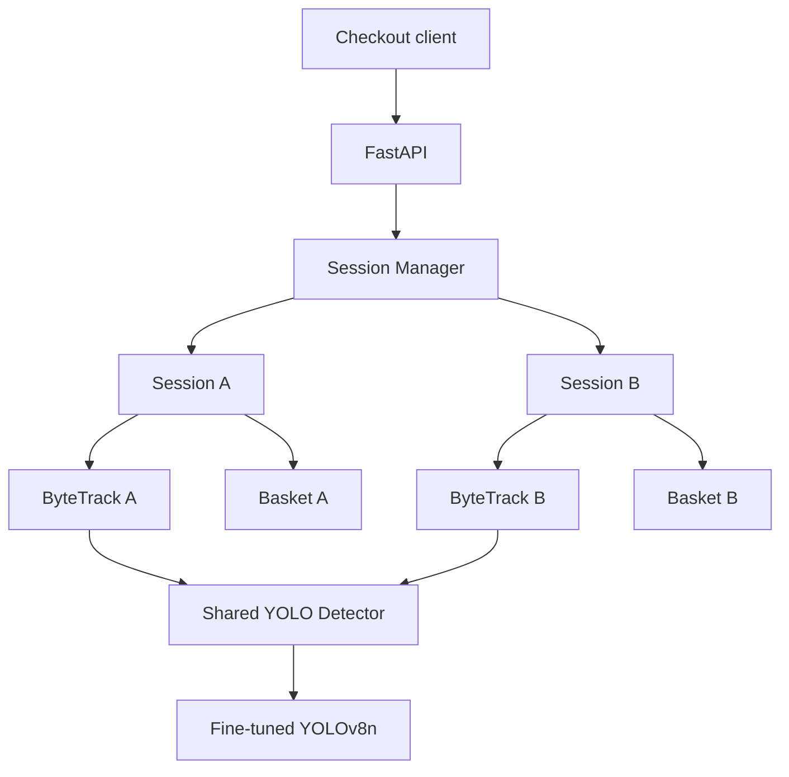

# Smart Checkout Vision Pipeline

An end-to-end computer vision project for supermarket checkout
assistance. It detects supermarket products with a fine-tuned YOLOv8
model, tracks detected objects across video frames with ByteTrack, and
exposes tracking and basket state through a FastAPI service.

The API uses a **session-based architecture**: each checkout session has
its own tracker and basket state, while all sessions share one YOLO
detector instance.

## Highlights

-   **Product detection:** fine-tuned YOLOv8n model for 15 supermarket
    product classes.
-   **Multi-object tracking:** ByteTrack associates detections across
    consecutive frames.
-   **Session isolation:** independent tracker and basket state for each
    checkout session.
-   **Shared inference resource:** one YOLO model is reused across
    sessions, with inference protected by a lock.
-   **Concurrency safeguards:** per-session locking protects that
    session's mutable tracking and basket state.
-   **Session lifecycle management:** sessions can be created and
    deleted, and idle sessions are periodically cleaned up.
-   **REST API:** FastAPI endpoints for frame processing, basket
    summaries, and session management.
-   **Containerization:** Dockerfile provided for a CPU-based container
    setup.
-   **Automated tests:** unit and API tests cover basket management,
    session isolation, lifecycle behavior, and frame processing.

## Architecture



### Request flow

1.  A client creates a checkout session through `POST /sessions`.
2.  The session manager creates an independent tracker and basket for
    that session.
3.  The client submits an image frame to the session-specific detection
    endpoint.
4.  The shared YOLO detector runs inference; ByteTrack updates only the
    selected session's tracking state.
5.  The API returns active tracked objects and the current basket
    summary.
6.  The session can be queried, reset, or deleted. Idle sessions are
    removed automatically.

### Session and resource model

  -----------------------------------------------------------------------
  Component               Scope                   Responsibility
  ----------------------- ----------------------- -----------------------
  YOLO detector           Shared across sessions  Runs product detection
                                                  using the fine-tuned
                                                  model

  Inference lock          Shared                  Prevents concurrent
                                                  calls to the shared
                                                  model instance

  ByteTrack tracker       One per session         Maintains object
                                                  identities across
                                                  frames for that session

  Basket manager          One per session         Stores products
                                                  registered by track ID
                                                  and produces a summary

  Session lock            One per session         Protects that session's
                                                  mutable state

  Session manager         Application process     Creates, accesses,
                                                  deletes, and expires
                                                  sessions
  -----------------------------------------------------------------------

The session idle timeout is **30 minutes** by default. A background task
checks for expired sessions every **60 seconds**.

## Model Performance

The repository's existing validation benchmark reports:

  Metric                                      Result
  ----------------- --------------------------------
  Model                           Fine-tuned YOLOv8n
  Product classes                                 15
  mAP@50                                       88.5%
  mAP@50--95                                   0.583
  Inference time      Approximately 2.2 ms per frame

These are model validation results, not end-to-end API latency
measurements. The inference-time figure is the reported validation
benchmark and should not be interpreted as total request processing
time.

Model weights are expected at `models/best.pt`.

## Tech Stack

-   **Python**
-   **Ultralytics YOLOv8**
-   **OpenCV**
-   **ByteTrack**
-   **FastAPI**
-   **NumPy**
-   **Docker**
-   **pytest**

## API

When the application is running, interactive API documentation is
available at:

-   Swagger UI: `http://localhost:8000/docs`
-   ReDoc: `http://localhost:8000/redoc`

### Endpoints

  ---------------------------------------------------------------------------------------
  Method                  Endpoint                                Description
  ----------------------- --------------------------------------- -----------------------
  `GET`                   `/health`                               Returns API/model
                                                                  status and the number
                                                                  of registered sessions

  `POST`                  `/sessions`                             Creates a new checkout
                                                                  session

  `DELETE`                `/sessions/{session_id}`                Deletes a session when
                                                                  it has no active
                                                                  requests

  `POST`                  `/sessions/{session_id}/detect-frame`   Detects and tracks
                                                                  products for one
                                                                  session

  `GET`                   `/sessions/{session_id}/basket`         Returns that session's
                                                                  basket summary

  `POST`                  `/sessions/{session_id}/basket/reset`   Resets that session's
                                                                  basket and tracker
                                                                  state
  ---------------------------------------------------------------------------------------

Unknown or expired session IDs return **404**. A session cannot be
deleted while it is being used; in that case the API returns **409**.

### Example: create a session

``` bash
curl -X POST http://localhost:8000/sessions
```

Example response:

``` json
{
  "session_id": "YOUR_SESSION_ID",
  "status": "created"
}
```

### Example: process an image frame

Replace `YOUR_SESSION_ID` with the ID returned by the create-session
endpoint.

``` bash
curl -X POST \
  "http://localhost:8000/sessions/YOUR_SESSION_ID/detect-frame" \
  -F "file=@assets/val_batch0_pred.jpg"
```

The response contains the session ID, the active detections, and the
current basket summary. To request an annotated image encoded as Base64,
add `?return_image=true` to the endpoint URL.

### Example: get the basket summary

``` bash
curl http://localhost:8000/sessions/YOUR_SESSION_ID/basket
```

### Example: reset a basket

``` bash
curl -X POST \
  http://localhost:8000/sessions/YOUR_SESSION_ID/basket/reset
```

### Example: delete a session

``` bash
curl -X DELETE \
  http://localhost:8000/sessions/YOUR_SESSION_ID
```

## Getting Started

### Prerequisites

-   Python 3.12 (recommended, matching the Docker base image)
-   Git
-   The trained model file at `models/best.pt`

### Run locally

Clone the repository and move into the project directory:

``` bash
git clone https://github.com/RasulAramian/smart-checkout-vision-pipeline.git
cd smart-checkout-vision-pipeline
```

Create and activate a virtual environment:

``` bash
python -m venv .venv
source .venv/bin/activate
```

Install dependencies:

``` bash
pip install --upgrade pip
pip install -r requirements.txt
```

Start the API:

``` bash
uvicorn app:app --host 0.0.0.0 --port 8000
```

Open `http://localhost:8000/docs` to explore and call the endpoints.

### Run with Docker

Build the image:

``` bash
docker build -t smart-checkout-vision .
```

Run the container:

``` bash
docker run --rm -p 8000:8000 smart-checkout-vision
```

The Dockerfile installs CPU versions of PyTorch and torchvision. The
model file must be present in `models/best.pt` when the image is built.

## Tests

Run the test suite from the repository root:

``` bash
pytest -v
```

The tests cover:

-   Basket item registration, duplicate track IDs, removal, summaries,
    and reset behavior.
-   Independent tracker and basket state across sessions.
-   Session creation, deletion, expiration, and cleanup.
-   Protection against deleting a session while it is in use.
-   API behavior for session and basket endpoints.
-   Frame processing using the sample validation image.
-   Startup and shutdown of the periodic cleanup task.

The latest recorded test run for the session-based implementation
completed with **29 passed** and one non-blocking deprecation warning.

## Project Structure

``` text
smart-checkout-vision-pipeline/
├── app.py
├── src/
│   ├── basket_manager.py
│   ├── basket_tracker.py
│   └── session_manager.py
├── models/
│   └── best.pt
├── notebooks/
│   └── 01_train_yolov8_detector.ipynb
├── assets/
│   └── validation and evaluation assets
├── tests/
│   ├── test_api.py
│   ├── test_basket_manager.py
│   ├── test_basket_tracker.py
│   └── test_session_manager.py
├── Dockerfile
└── requirements.txt
```

## Current Scope and Limitations

This project currently demonstrates product detection, frame-to-frame
object tracking, per-session tracking state, and track-ID-based basket
summaries.

**It does not yet implement visual event recognition for a customer
physically picking a product from a shelf or returning it.** A newly
observed track can be registered in the session basket, but the current
pipeline does not determine shelf-to-basket movement or reliably infer
pickup/return events.

Additional implementation boundaries:

-   Session state is held in application memory; it is not persisted
    across process restarts.
-   The session manager is process-local. A multi-worker or
    multi-instance deployment would need shared session storage and
    coordination.
-   The API currently has no authentication or authorization layer.
-   The reported model benchmark is not a measure of complete
    checkout-system accuracy or end-to-end API latency.

## License

No license has been specified for this repository yet.
